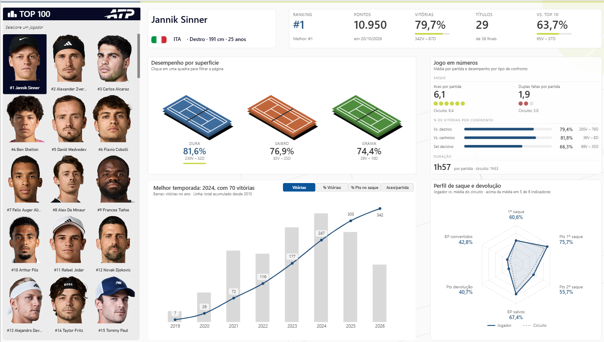
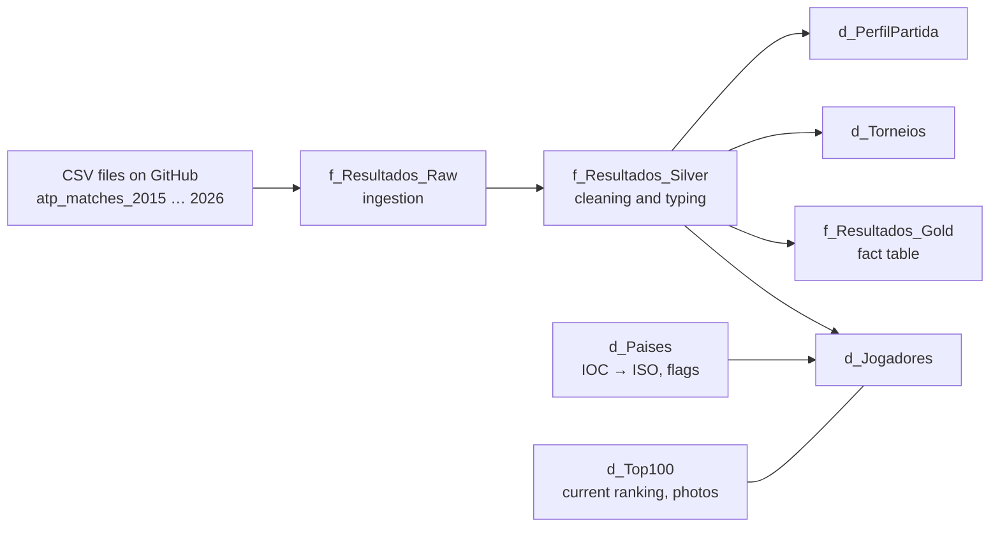

# ATP Analytics Dashboard · Power BI

🇺🇸 English · [🇧🇷 Português](README.pt-BR.md)

A Power BI dashboard that analyzes the performance of the current ATP top 100, built with a layered data architecture (Raw → Silver → Gold), a star-schema model, and custom HTML and SVG visuals generated with DAX.



## Contents

- [Scope of the analysis](#scope-of-the-analysis)
- [Data sources](#data-sources)
- [Data architecture](#data-architecture)
- [Data cleaning](#data-cleaning)
- [Data model](#data-model)
- [Metric definitions](#metric-definitions)
- [Dashboard walkthrough](#dashboard-walkthrough)
- [Technical highlights](#technical-highlights)
- [Repository structure](#repository-structure)
- [How to open the project](#how-to-open-the-project)
- [Known limitations](#known-limitations)
- [Credits and disclaimer](#credits-and-disclaimer)

## Scope of the analysis

| Item | Scope |
|---|---|
| **Period** | Tournaments starting from January 4, 2015 to May 25, 2026 (Roland Garros 2026 is the last event in the data). |
| **Tournaments included** | Every tour-level event that awards ATP ranking points: Grand Slams, ATP Masters 1000, ATP 500, ATP 250, ATP Finals, ATP Cup and United Cup. |
| **Tournaments excluded** | Laver Cup and NextGen ATP Finals (exhibition / no ranking points), the Rio 2016 and Tokyo 2021 Olympics (no ranking points), Davis Cup, Challengers, ITF events and qualifying rounds. |
| **Players available for selection** | The ATP top 100 of October 20, 2026. The model keeps every player in the data (≈ 814), so head-to-head and opponent analysis still works. |
| **Volume** | 29,192 matches in 720 tournament editions. |

Matches by tournament level:

| Level | Code | Matches | Editions |
|---|---|---|---|
| ATP 500 / 250 (and ATP Cup / United Cup) | `A` | 16,666 | 567 |
| ATP Masters 1000 | `M` | 6,631 | 96 |
| Grand Slams | `G` | 5,715 | 45 |
| ATP Finals | `F` | 180 | 12 |

## Data sources

| Data | Source | License / use |
|---|---|---|
| Matches, players and match statistics | Jeff Sackmann / Tennis Abstract, via the archival mirror [tennis-sackmann-archive](https://github.com/Aneeshers/tennis-sackmann-archive) (the original `JeffSackmann/tennis_atp` repository is no longer available) | [CC BY-NC-SA 4.0](https://creativecommons.org/licenses/by-nc-sa/4.0/): attribution, non-commercial use only |
| Current ranking and points (top 100) | ATP Tour rankings page, October 20, 2026 | Manually captured snapshot |
| Player headshots | Official ATP Tour headshots, linked by each player's ATP code | Used only to identify players; copyright belongs to the ATP |
| Country flags | [Flagpedia / FlagCDN](https://flagpedia.net) | Public domain |

## Data architecture



| Layer | Query | Role |
|---|---|---|
| **Raw** | `f_Resultados_Raw` | Reads the yearly CSV files (2015–2026) straight from GitHub with `Web.Contents` and appends them. No transformation. Not loaded to the model. |
| **Silver** | `f_Resultados_Silver` | Filters tournaments, cleans text, fixes records, derives the match profile, renames columns to Portuguese and applies data types. Not loaded to the model. |
| **Gold** | `f_Resultados_Gold` and dimensions | Keeps only keys, match attributes and metrics. These are the tables loaded to the model. |

The Raw layer uses a fixed base URL with `RelativePath`, so scheduled refresh in the Power BI Service works without a gateway.

## Data cleaning

All cleaning happens in the Silver layer, in this order:

1. **Tournament filter:** only levels `G`, `M`, `A` and `F`, then removal of Laver Cup, NextGen Finals and both Olympics.
2. **Text cleanup:** `Text.Trim` + `Text.Clean` on every text column; empty strings converted to `null`.
3. **Tournament names:** `ATP ` prefix and dots removed, extra spaces collapsed and spelling unified (`Rio De Janeiro` → `Rio de Janeiro`, `Atp Cup` → `ATP Cup`, `s Hertogenbosch` → `'s-Hertogenbosch`). Numbered editions held twice in the same year (`Adelaide 1`, `Adelaide 2`) keep their number.
4. **Entry codes:** standardized (`Alt` → `ALT`, `W` → `WC`, `S` → `SE`, `L` → `LL`). A null entry means direct acceptance.
5. **Record fixes:**
    - One player with two IDs unified (Martín Landaluce: `211776` → `212021`).
    - Corrupted name fixed (`Alejandro Gomez Gb42` → `Alejandro Gomez`).
    - Lebanon's country code standardized to the IOC code (`LBN` → `LIB`).
    - Unknown handedness (`U`) set to `null`.
    - `Def.` standardized to `DEF` in the score.
6. **Impossible values:** match durations above 300 minutes set to `null` (two best-of-3 matches recorded at 987 and 1,146 minutes).
7. **Walkovers:** W.O. matches (190) have their duration and every serve statistic set to `null`, since the match was never played.
8. **Match profile:** derived from the score — how the match ended (normal, retirement, walkover, default), number of sets played and number of tie-breaks.
9. **Column names** translated to Portuguese in `snake_case` (e.g. `w_1stWon` → `pontos_ganhos_primeiro_saque_vencedor`).
10. **Data types:** applied at the end with a safe-typing function (`fxTipoSeguro`). The date is converted from `yyyyMMdd`, and age is read with the `en-US` culture so that `25.5` is not read as `255` under the `pt-BR` locale.

## Data model

Star schema with one fact table (one row per match) and its dimensions.

| Table | Type | Grain / content |
|---|---|---|
| `f_Resultados_Gold` | Fact | One row per match: keys, score, duration, both players' rank/age/seed/entry/hand at match time and 18 serve statistics. |
| `d_Jogadores` | Dimension | One row per player: name, hand, height, country, country name and flag. |
| `d_Torneios` | Dimension | One row per tournament edition: name and surface. |
| `d_Calendario` | Dimension | Date table, 2014 to the current year. |
| `d_Rodada` | Dimension | Round name in Portuguese and sort order (R128 … Final, round robin). |
| `d_PerfilPartida` | Dimension | How the match ended, number of sets and tie-breaks. |
| `d_Top100` | Dimension | Current ranking, points, ATP code and headshot URL. |
| `d_MetricaTrajetoria` | Disconnected | Options for the metric selector of the season chart. |

**Relationships**

| From | To | Status |
|---|---|---|
| `f_Resultados_Gold[id_vencedor]` | `d_Jogadores[id_jogador]` | Active |
| `f_Resultados_Gold[id_perdedor]` | `d_Jogadores[id_jogador]` | Inactive (activated with `USERELATIONSHIP`) |
| `f_Resultados_Gold[id_torneio]` | `d_Torneios[id_torneio]` | Active |
| `f_Resultados_Gold[data_torneio]` | `d_Calendario[Data]` | Active |
| `f_Resultados_Gold[rodada]` | `d_Rodada[rodada]` | Active |
| `f_Resultados_Gold[id_perfil_partida]` | `d_PerfilPartida[id_perfil_partida]` | Active |
| `d_Top100[id_jogador]` | `d_Jogadores[id_jogador]` | 1:1 |

Every match has two players. Winner-side measures use the active relationship, and loser-side measures switch to the inactive one, so each player metric adds both sides of the match.

## Metric definitions

The model has 64 measures. The main definitions:

| Metric | Definition |
|---|---|
| **Wins / Losses** | Matches won / lost. Walkovers are excluded, following the ATP win-loss record. |
| **Win %** | Wins ÷ (wins + losses). |
| **Titles / Finals** | Wins in the final round / finals played. |
| **Win % vs. top 10** | Win % against opponents ranked in the top 10 **on the match date**. |
| **Win % vs. right/left-handers** | Win % by the opponent's playing hand. |
| **Win % in 3-set matches** | Matches that ended normally after exactly three sets. |
| **1st serve %** | First serves in ÷ service points played. |
| **1st / 2nd serve points won %** | Points won on 1st serve ÷ first serves in; points won on 2nd serve ÷ (service points − first serves in). |
| **Service points won %** | (1st + 2nd serve points won) ÷ service points played. |
| **Break points saved %** | Break points saved ÷ break points faced. |
| **Return points won %** | Opponent's service points not won by the opponent ÷ opponent's service points. |
| **Break points converted %** | Opponent's break points faced − saved ÷ opponent's break points faced. |
| **Aces / double faults per match** | Total ÷ matches with statistics available. |
| **Circuit average** | The same metric computed over every match in the current filter context, without the player filter. |
| **Best ranking** | Lowest ranking recorded in the data or the current ranking, whichever is better. |

Percentages are always computed as a ratio of totals, never as an average of match percentages.

## Dashboard walkthrough

The page follows a Z reading pattern and the principles of *Storytelling with Data*: one accent color, gray for context, takeaway titles and no chart clutter.

| Area | What it shows |
|---|---|
| **Player panel** (left) | A grid with the top 100 headshots, ordered by ranking. Clicking a photo selects the player. |
| **Header** | Name, flag, country, hand, height and age, plus KPIs: current ranking (and best), points, win % with record, titles out of finals, and win % against the top 10. |
| **Performance by surface** | Three clickable isometric courts (hard, clay, grass). Clicking one filters the whole page by surface. |
| **Game in numbers** | Aces and double faults per match vs. the circuit, win % against right- and left-handers and in 3-set matches, and average match duration. |
| **Serve and return profile** | SVG radar with six indicators for the player and the circuit average, plus how many indicators are above average. |
| **Season trajectory** | Columns for each season and a line for the career-to-date value, with a selector: wins, win %, service points won % and aces per match. The title names the best season automatically. |

## Technical highlights

- **HTML cards generated with DAX** and rendered with HTML Content (lite): typography, spacing and progress bars controlled with CSS.
- **Radar chart drawn as SVG by a DAX measure:** coordinates calculated with sine and cosine, a 30–80% scale to highlight differences, values written at each axis.
- **Clickable isometric courts:** a custom SVG with one area per surface, bound to the surface dimension.
- **Metric selector** with a disconnected table, `SWITCH` measures and **dynamic format strings**, so the same chart shows counts, percentages and averages with the right format.
- **Career-to-date line** that recalculates any metric over all seasons up to the one on the axis.
- **PBIP project with the model in TMDL:** Power Query, DAX and relationships are versioned as plain text.

## Repository structure

```
├── Projeto_Tenis.pbip                 # Open this file in Power BI Desktop
├── Projeto_Tenis.Report/              # Report: page, visuals, images
├── Projeto_Tenis.SemanticModel/
│   └── definition/
│       ├── expressions.tmdl           # Raw, Silver and d_Paises queries (Power Query M)
│       ├── relationships.tmdl         # Model relationships
│       └── tables/                    # One .tmdl file per table (Gold queries, columns, measures)
├── docs/                              # Images used in this README
├── README.md                          # English
└── README.pt-BR.md                    # Português
```

## How to open the project

**Requirements**
- A recent version of Power BI Desktop (with PBIP and TMDL support).
- Custom visuals from AppSource: **HTML Content (lite)** and **Synoptic Panel by OKViz**.
- Internet access during refresh (the data is read from GitHub, the photos from the ATP website and the flags from FlagCDN).

**Steps**
1. Clone the repository or download it as a ZIP.
2. Open `Projeto_Tenis.pbip` in Power BI Desktop.
3. Click **Refresh**. The data cache is not stored in the repository.
4. If asked for the privacy level of the GitHub source, choose **Anonymous** and **Public**.

## Known limitations

- **Match data ends with Roland Garros 2026** (tournaments starting by May 25, 2026). The 2026 season is partial.
- **Two reference dates:** match-based metrics run until May 2026, while the current ranking and points are from October 20, 2026.
- **Ranking in the match data** is the player's ranking on the tournament start date, not an end-of-season ranking.
- **Missing statistics:** 136 played matches have no serve statistics in the source; they are left out of serve metrics through the "matches with statistics" denominator.
- **3-set matches include Grand Slam straight-set matches:** in best-of-5 matches, three sets means a straight-set result, not a deciding set.
- **Small samples:** splits such as left-handed opponents or 3-set matches can rely on few matches; the win-loss record is always shown next to the percentage.
- **Top 100 table is manual** and needs to be updated by hand when the ranking changes.
- **Toby Samuel** (no. 96) has no tour-level matches in the data and does not appear in the selector.
- **Russian and Belarusian players** compete as neutral athletes on the ATP Tour; the data still records their country codes.
- **Synoptic Panel (free version)** works in Power BI Desktop and the Power BI Service, but *Publish to Web* requires a paid license.

## Credits and disclaimer

- Match data: **Jeff Sackmann / Tennis Abstract**, licensed under CC BY-NC-SA 4.0.
- Player headshots and rankings: **ATP Tour**.
- Flags: **Flagpedia / FlagCDN**.

This is a personal, non-commercial portfolio project. It is not affiliated with, endorsed by or sponsored by the ATP.

## Author

**Claudio Monteiro** · Data analytics and BI (Power BI, DAX, Power Query M, SQL, Microsoft Fabric)
