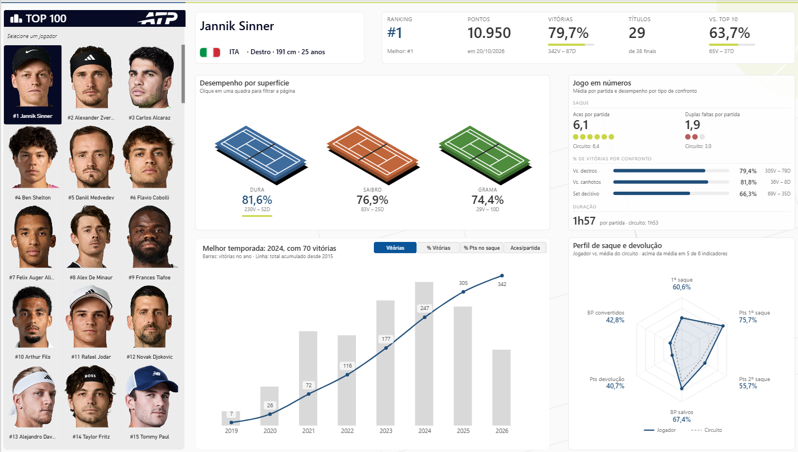
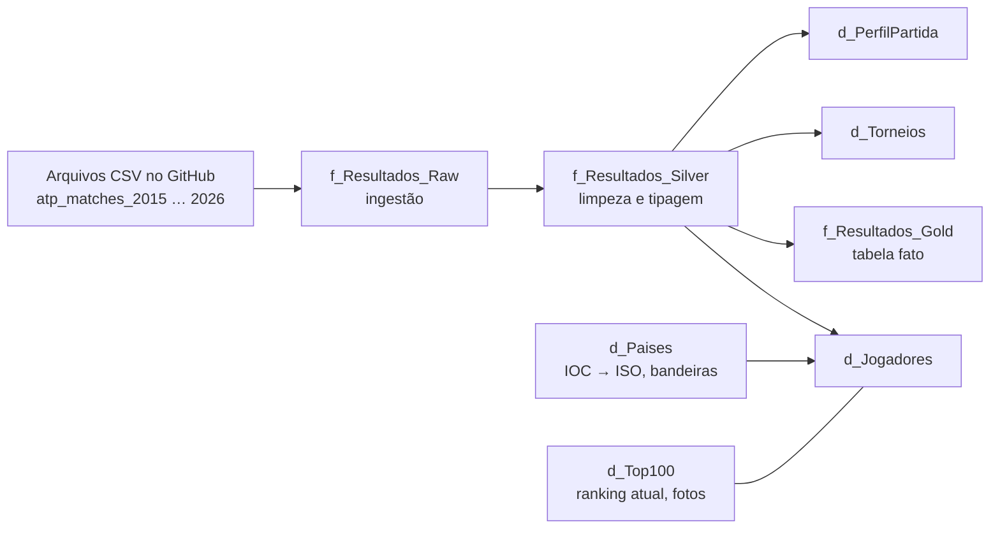

# ATP Analytics Dashboard · Power BI

[🇺🇸 English](README.md) · 🇧🇷 Português

Dashboard em Power BI que analisa o desempenho dos jogadores do top 100 atual da ATP, construído com arquitetura de dados em camadas (Raw → Silver → Gold), modelo em estrela e visuais personalizados em HTML e SVG gerados por DAX.



## Sumário

- [Escopo da análise](#escopo-da-análise)
- [Fontes de dados](#fontes-de-dados)
- [Arquitetura dos dados](#arquitetura-dos-dados)
- [Limpeza dos dados](#limpeza-dos-dados)
- [Modelo de dados](#modelo-de-dados)
- [Definição das métricas](#definição-das-métricas)
- [O que o dashboard mostra](#o-que-o-dashboard-mostra)
- [Destaques técnicos](#destaques-técnicos)
- [Estrutura do repositório](#estrutura-do-repositório)
- [Como abrir o projeto](#como-abrir-o-projeto)
- [Limitações conhecidas](#limitações-conhecidas)
- [Créditos e aviso](#créditos-e-aviso)

## Escopo da análise

| Item | Escopo |
|---|---|
| **Período** | Torneios iniciados entre 4 de janeiro de 2015 e 25 de maio de 2026 (Roland Garros 2026 é o último evento da base). |
| **Torneios incluídos** | Todos os torneios do circuito principal que dão pontos no ranking ATP: Grand Slams, ATP Masters 1000, ATP 500, ATP 250, ATP Finals, ATP Cup e United Cup. |
| **Torneios excluídos** | Laver Cup e NextGen ATP Finals (exibição / sem pontos no ranking), Olimpíadas do Rio 2016 e de Tóquio 2021 (sem pontos no ranking), Copa Davis, Challengers, torneios ITF e qualifying. |
| **Jogadores disponíveis para seleção** | O top 100 da ATP de 20 de outubro de 2026. O modelo mantém todos os jogadores da base (≈ 814), então a análise de adversários continua funcionando. |
| **Volume** | 29.192 partidas em 720 edições de torneios. |

Partidas por nível de torneio:

| Nível | Código | Partidas | Edições |
|---|---|---|---|
| ATP 500 / 250 (e ATP Cup / United Cup) | `A` | 16.666 | 567 |
| ATP Masters 1000 | `M` | 6.631 | 96 |
| Grand Slams | `G` | 5.715 | 45 |
| ATP Finals | `F` | 180 | 12 |

## Fontes de dados

| Dado | Fonte | Licença / uso |
|---|---|---|
| Partidas, jogadores e estatísticas das partidas | Jeff Sackmann / Tennis Abstract, pelo espelho de arquivo [tennis-sackmann-archive](https://github.com/Aneeshers/tennis-sackmann-archive) (o repositório original `JeffSackmann/tennis_atp` não está mais disponível) | [CC BY-NC-SA 4.0](https://creativecommons.org/licenses/by-nc-sa/4.0/): atribuição obrigatória, apenas uso não comercial |
| Ranking e pontos atuais (top 100) | Página de rankings do ATP Tour, 20 de outubro de 2026 | Retrato capturado manualmente |
| Fotos dos jogadores | Fotos oficiais do ATP Tour, ligadas pelo código ATP de cada jogador | Usadas apenas para identificar os jogadores; os direitos são da ATP |
| Bandeiras | [Flagpedia / FlagCDN](https://flagpedia.net) | Domínio público |

## Arquitetura dos dados



| Camada | Consulta | Papel |
|---|---|---|
| **Raw** | `f_Resultados_Raw` | Lê os CSVs anuais (2015–2026) direto do GitHub com `Web.Contents` e junta todos. Nenhuma transformação. Não é carregada no modelo. |
| **Silver** | `f_Resultados_Silver` | Filtra os torneios, limpa textos, corrige registros, deriva o perfil da partida, renomeia as colunas para português e aplica a tipagem. Não é carregada no modelo. |
| **Gold** | `f_Resultados_Gold` e dimensões | Mantém só as chaves, os atributos da partida e as métricas. São as tabelas carregadas no modelo. |

A camada Raw usa uma URL base fixa com `RelativePath`, então a atualização agendada no Serviço do Power BI funciona sem gateway.

## Limpeza dos dados

Toda a limpeza é feita na camada Silver, nesta ordem:

1. **Filtro de torneios:** só os níveis `G`, `M`, `A` e `F`, e depois a retirada da Laver Cup, do NextGen Finals e das duas Olimpíadas.
2. **Limpeza de texto:** `Text.Trim` + `Text.Clean` em todas as colunas de texto; textos vazios convertidos em `null`.
3. **Nomes de torneio:** retirada do prefixo `ATP ` e dos pontos, espaços extras unificados e grafias padronizadas (`Rio De Janeiro` → `Rio de Janeiro`, `Atp Cup` → `ATP Cup`, `s Hertogenbosch` → `'s-Hertogenbosch`). Edições numeradas, disputadas duas vezes no mesmo ano (`Adelaide 1`, `Adelaide 2`), mantêm o número.
4. **Códigos de entrada:** padronizados (`Alt` → `ALT`, `W` → `WC`, `S` → `SE`, `L` → `LL`). Entrada nula significa entrada direta.
5. **Correções de registros:**
    - Jogador com dois IDs unificado (Martín Landaluce: `211776` → `212021`).
    - Nome corrompido corrigido (`Alejandro Gomez Gb42` → `Alejandro Gomez`).
    - Código de país do Líbano padronizado para o código do COI (`LBN` → `LIB`).
    - Mão desconhecida (`U`) convertida em `null`.
    - `Def.` padronizado para `DEF` no placar.
6. **Valores impossíveis:** durações acima de 300 minutos convertidas em `null` (duas partidas em melhor de 3 registradas com 987 e 1.146 minutos).
7. **W.O.:** as partidas com W.O. (190) ficam sem duração e sem estatísticas de saque, já que não foram disputadas.
8. **Perfil da partida:** derivado do placar — forma de término (normal, abandono, W.O., desclassificação), número de sets disputados e número de tie-breaks.
9. **Nomes das colunas** traduzidos para português em `snake_case` (por exemplo, `w_1stWon` → `pontos_ganhos_primeiro_saque_vencedor`).
10. **Tipagem:** aplicada no final com uma função de tipagem segura (`fxTipoSeguro`). A data é convertida do formato `yyyyMMdd`, e a idade é lida com a cultura `en-US`, para que `25.5` não vire `255` na localidade `pt-BR`.

## Modelo de dados

Modelo em estrela, com uma tabela fato (uma linha por partida) e as dimensões.

| Tabela | Tipo | Granularidade / conteúdo |
|---|---|---|
| `f_Resultados_Gold` | Fato | Uma linha por partida: chaves, placar, duração, ranking/idade/cabeça de chave/entrada/mão dos dois jogadores na data da partida e 18 estatísticas de saque. |
| `d_Jogadores` | Dimensão | Uma linha por jogador: nome, mão, altura, país, nome do país e bandeira. |
| `d_Torneios` | Dimensão | Uma linha por edição de torneio: nome e superfície. |
| `d_Calendario` | Dimensão | Tabela de datas, de 2014 até o ano atual. |
| `d_Rodada` | Dimensão | Nome da rodada em português e ordem de classificação (R128 … Final, fase de grupos). |
| `d_PerfilPartida` | Dimensão | Forma de término, número de sets e de tie-breaks. |
| `d_Top100` | Dimensão | Ranking atual, pontos, código ATP e URL da foto. |
| `d_MetricaTrajetoria` | Desconectada | Opções do seletor de métrica do gráfico de temporadas. |

**Relacionamentos**

| De | Para | Status |
|---|---|---|
| `f_Resultados_Gold[id_vencedor]` | `d_Jogadores[id_jogador]` | Ativo |
| `f_Resultados_Gold[id_perdedor]` | `d_Jogadores[id_jogador]` | Inativo (ativado com `USERELATIONSHIP`) |
| `f_Resultados_Gold[id_torneio]` | `d_Torneios[id_torneio]` | Ativo |
| `f_Resultados_Gold[data_torneio]` | `d_Calendario[Data]` | Ativo |
| `f_Resultados_Gold[rodada]` | `d_Rodada[rodada]` | Ativo |
| `f_Resultados_Gold[id_perfil_partida]` | `d_PerfilPartida[id_perfil_partida]` | Ativo |
| `d_Top100[id_jogador]` | `d_Jogadores[id_jogador]` | 1:1 |

Cada partida tem dois jogadores. As medidas do lado do vencedor usam o relacionamento ativo, e as do lado do perdedor trocam para o inativo. Assim, cada métrica do jogador soma os dois lados da partida.

## Definição das métricas

O modelo tem 64 medidas. As principais definições:

| Métrica | Definição |
|---|---|
| **Vitórias / Derrotas** | Partidas vencidas / perdidas. W.O. não entra, como no retrospecto oficial da ATP. |
| **% de vitórias** | Vitórias ÷ (vitórias + derrotas). |
| **Títulos / Finais** | Vitórias em finais / finais disputadas. |
| **% de vitórias contra top 10** | % de vitórias contra adversários que estavam no top 10 **na data da partida**. |
| **% de vitórias contra destros / canhotos** | % de vitórias de acordo com a mão do adversário. |
| **% de vitórias em 3 sets** | Partidas terminadas normalmente após exatamente três sets. |
| **% de 1º saque** | Primeiros saques dentro ÷ pontos disputados no saque. |
| **% de pontos ganhos com o 1º / 2º saque** | Pontos ganhos com o 1º saque ÷ primeiros saques dentro; pontos ganhos com o 2º saque ÷ (pontos disputados no saque − primeiros saques dentro). |
| **% de pontos ganhos no saque** | (Pontos ganhos com o 1º + 2º saque) ÷ pontos disputados no saque. |
| **% de break points salvos** | Break points salvos ÷ break points enfrentados. |
| **% de pontos ganhos na devolução** | Pontos de saque do adversário que ele não venceu ÷ pontos de saque do adversário. |
| **% de break points convertidos** | (Break points enfrentados pelo adversário − salvos por ele) ÷ break points enfrentados pelo adversário. |
| **Aces / duplas faltas por partida** | Total ÷ partidas com estatísticas disponíveis. |
| **Média do circuito** | A mesma métrica calculada sobre todas as partidas no contexto de filtro atual, sem o filtro do jogador. |
| **Melhor ranking** | O menor ranking registrado na base ou o ranking atual, o que for melhor. |

Os percentuais são sempre calculados como razão entre totais, e nunca como média dos percentuais de cada partida.

## O que o dashboard mostra

A página segue a leitura em Z e os princípios do *Storytelling com Dados*: uma única cor de destaque, cinza para o contexto, títulos com a conclusão e nenhuma poluição visual nos gráficos.

| Área | O que mostra |
|---|---|
| **Painel de jogadores** (esquerda) | Grade com as fotos do top 100, em ordem de ranking. Clicar numa foto seleciona o jogador. |
| **Cabeçalho** | Nome, bandeira, país, mão, altura e idade, além dos KPIs: ranking atual (e o melhor), pontos, % de vitórias com o retrospecto, títulos sobre finais e % de vitórias contra top 10. |
| **Desempenho por superfície** | Três quadras isométricas clicáveis (dura, saibro e grama). Clicar numa delas filtra a página inteira pela superfície. |
| **Jogo em números** | Aces e duplas faltas por partida comparados ao circuito, % de vitórias contra destros, contra canhotos e em partidas de 3 sets, e duração média das partidas. |
| **Perfil de saque e devolução** | Radar em SVG com seis indicadores do jogador e a média do circuito, além de quantos indicadores estão acima da média. |
| **Trajetória por temporada** | Colunas com o valor de cada temporada e linha com o valor acumulado da carreira, com seletor: vitórias, % de vitórias, % de pontos ganhos no saque e aces por partida. O título indica a melhor temporada automaticamente. |

## Destaques técnicos

- **Cartões em HTML gerados por DAX** e exibidos com o HTML Content (lite): tipografia, espaçamentos e barras de progresso controlados por CSS.
- **Gráfico de radar desenhado em SVG por uma medida DAX:** coordenadas calculadas com seno e cosseno, escala de 30% a 80% para destacar as diferenças e valores escritos em cada eixo.
- **Quadras isométricas clicáveis:** um SVG próprio com uma área por superfície, ligado à dimensão de superfície.
- **Seletor de métrica** com tabela desconectada, medidas com `SWITCH` e **cadeias de formato dinâmicas**, para o mesmo gráfico mostrar contagens, percentuais e médias com o formato certo.
- **Linha acumulada da carreira**, que recalcula qualquer métrica com todas as temporadas até a do eixo.
- **Projeto PBIP com o modelo em TMDL:** Power Query, DAX e relacionamentos versionados como texto.

## Estrutura do repositório

```
├── Projeto_Tenis.pbip                 # Abra este arquivo no Power BI Desktop
├── Projeto_Tenis.Report/              # Relatório: página, visuais e imagens
├── Projeto_Tenis.SemanticModel/
│   └── definition/
│       ├── expressions.tmdl           # Consultas Raw, Silver e d_Paises (Power Query M)
│       ├── relationships.tmdl         # Relacionamentos do modelo
│       └── tables/                    # Um arquivo .tmdl por tabela (consultas Gold, colunas, medidas)
├── docs/                              # Imagens usadas neste README
├── README.md                          # English
└── README.pt-BR.md                    # Português
```

## Como abrir o projeto

**Requisitos**
- Uma versão recente do Power BI Desktop (com suporte a PBIP e TMDL).
- Visuais personalizados do AppSource: **HTML Content (lite)** e **Synoptic Panel by OKViz**.
- Acesso à internet na atualização (os dados vêm do GitHub, as fotos do site da ATP e as bandeiras do FlagCDN).

**Passos**
1. Clone o repositório ou baixe como ZIP.
2. Abra o `Projeto_Tenis.pbip` no Power BI Desktop.
3. Clique em **Atualizar**. O cache de dados não fica no repositório.
4. Se o Power BI pedir o nível de privacidade da fonte do GitHub, escolha **Anônimo** e **Público**.

## Limitações conhecidas

- **Os dados de partidas terminam em Roland Garros 2026** (torneios iniciados até 25 de maio de 2026). A temporada de 2026 está incompleta.
- **Duas datas de referência:** as métricas de partidas vão até maio de 2026, e o ranking e os pontos atuais são de 20 de outubro de 2026.
- **O ranking nas partidas** é o ranking do jogador na data de início do torneio, e não o ranking de fim de temporada.
- **Estatísticas ausentes:** 136 partidas disputadas não têm estatísticas de saque na fonte; elas ficam fora das métricas de saque pelo denominador "partidas com estatística".
- **Partidas em 3 sets incluem vitórias diretas em Grand Slams:** nas partidas em melhor de 5, três sets significa vitória sem perder set, e não um set decisivo.
- **Amostras pequenas:** recortes como adversários canhotos ou partidas em 3 sets podem ter poucas partidas; o retrospecto de vitórias e derrotas sempre aparece ao lado do percentual.
- **A tabela do top 100 é manual** e precisa ser atualizada à mão quando o ranking mudar.
- **Toby Samuel** (96º) não tem partidas do circuito principal na base e não aparece no seletor.
- **Jogadores russos e bielorrussos** competem como atletas neutros no circuito ATP; a base ainda registra o código do país.
- **Synoptic Panel (versão gratuita)** funciona no Power BI Desktop e no Serviço do Power BI, mas a opção *Publicar na Web* exige licença paga.

## Créditos e aviso

- Dados de partidas: **Jeff Sackmann / Tennis Abstract**, sob licença CC BY-NC-SA 4.0.
- Fotos e rankings dos jogadores: **ATP Tour**.
- Bandeiras: **Flagpedia / FlagCDN**.

Este é um projeto pessoal de portfólio, sem fins comerciais. Não tem relação, aprovação nem patrocínio da ATP.

## Autor

**Claudio Monteiro** · Análise de dados e BI (Power BI, DAX, Power Query M, SQL, Microsoft Fabric)
